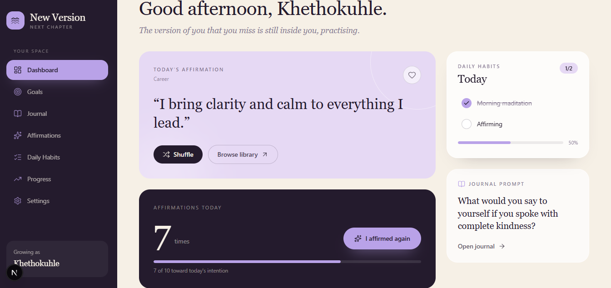
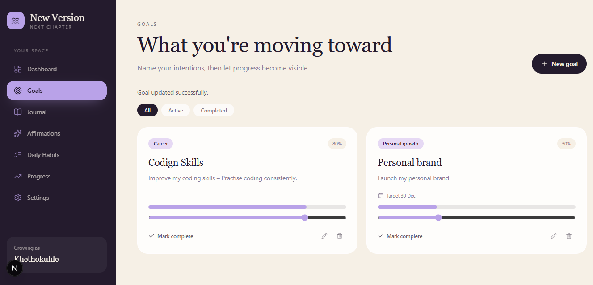
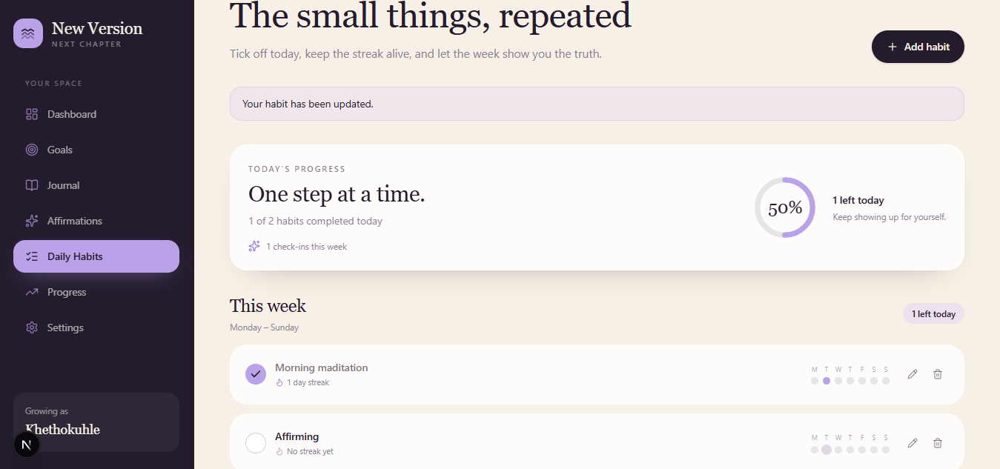
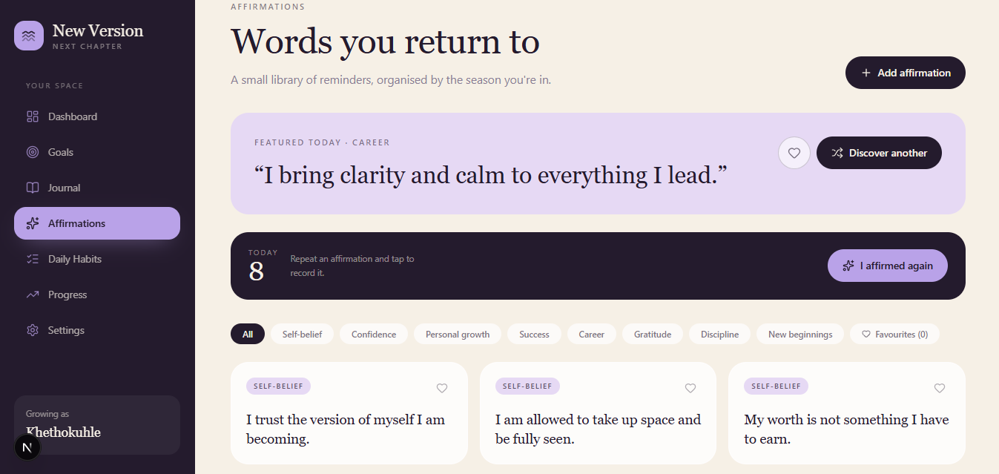
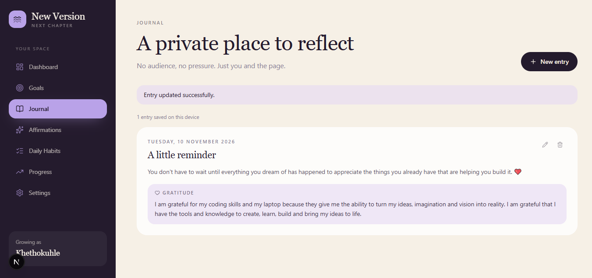
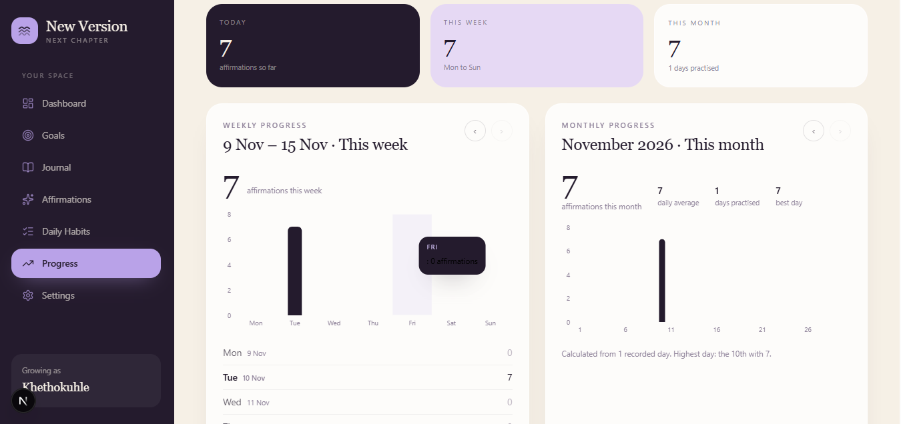

# New Version – Personal Growth & Manifestation App

**Your intentions. Your habits. Your next chapter.**

New Version is a personal growth and manifestation web application designed to help users organise their goals, build consistent habits, practise daily affirmations, and reflect on their personal development.

The application provides a central space for tracking intentions and daily progress through an elegant, responsive interface.

## Features

- **Dashboard:** View a daily overview of goals, habits, affirmations, and progress.
- **Goals:** Create, edit, delete, and track personal goals with progress indicators.
- **Daily Habits:** Create and manage habits, record daily completions, and track streaks.
- **Affirmations:** Browse affirmations, explore categories, save favourites, and create custom affirmations.
- **Affirmation Counter:** Track daily affirmation repetitions with automatically maintained historical totals.
- **Journal:** Write, edit, and revisit dated journal entries.
- **Progress Tracking:** Review daily, weekly, and monthly activity through summaries, history, and charts.
- **Settings:** Personalise application settings and manage locally stored application data.

## Technology Stack

| Technology | Purpose |
|---|---|
| Next.js | React framework and application routing |
| React | Component-based user interface |
| TypeScript | Type safety and maintainable code |
| Tailwind CSS | Responsive styling |
| Recharts | Progress visualisations |
| Lucide React | Interface icons |
| LocalStorage | Client-side data persistence |
| Jest | Automated unit testing |
| React Testing Library | Component testing |
| ESLint | Code quality and static analysis |
| Prettier | Consistent code formatting |

## Engineering Practices

The project incorporates:

- Reusable, component-based architecture.
- Type-safe application development.
- Custom React hooks for shared application state.
- Client-side persistence using browser LocalStorage.
- Utility-function unit tests.
- Automated code formatting and linting.
- Production build validation.
- Responsive design and reusable UI components.

## Getting Started

### Prerequisites

- Node.js
- npm
- Git

### Installation


### 1. Clone the repository

```bash
git clone https://github.com/Khethokuhle-Hadebe/new-version.git
```

### 2. Navigate to the project directory

```bash
cd new-version
```

### 3. Install dependencies

```bash
npm install
```

### 4. Start the development server

```bash
npm run dev
```

Open [http://localhost:3000](http://localhost:3000) in your browser.

## Available Scripts

| Command | Description |
|---|---|
| `npm run dev` | Start the development server |
| `npm run build` | Create an optimised production build |
| `npm run start` | Start the production server |
| `npm run lint` | Run ESLint |
| `npm test` | Run automated tests |
| `npm run test:coverage` | Generate test coverage |
| `npm run format` | Format project files with Prettier |
| `npm run format:check` | Check formatting consistency |

## Data Storage

New Version currently uses browser LocalStorage for application data persistence.

This means user data is stored locally in the browser rather than in a remote database. The current version does not require a backend, authentication service, or external API.

## Project Structure

```text
new-version/
├── public/
├── src/
│   ├── app/
│   │   ├── affirmations/
│   │   ├── goals/
│   │   ├── habits/
│   │   ├── journal/
│   │   ├── progress/
│   │   └── settings/
│   ├── components/
│   │   ├── affirmations/
│   │   ├── dashboard/
│   │   ├── goals/
│   │   ├── habits/
│   │   ├── journal/
│   │   ├── layout/
│   │   ├── progress/
│   │   └── shared/
│   ├── hooks/
│   └── lib/
├── jest.config.js
├── jest.setup.ts
├── package.json
└── README.md
```

## Application Screenshots

The following screenshots showcase the main features and user interface of New Version.

### Dashboard

The central dashboard provides an overview of daily affirmations, goals, habits, and personal progress.



### Goals

Create, manage, and track personal goals with progress indicators.



### Daily Habits

Build consistent routines by tracking daily habit completions and streaks.



### Affirmations

Explore affirmation categories, save favourites, and create personalised affirmations.



### Journal

Record personal reflections and gratitude through dated journal entries.



### Progress

Review daily, weekly, and monthly activity through progress summaries and charts.



## Future Improvements

Potential future enhancements include expanded automated test coverage, continuous integration, and additional application capabilities.

## Project Links

GitHub Repository: [New Version](https://github.com/Khethokuhle-Hadebe/new-version)

Live Demo: [New Version – Live Application](https://new-version-tau.vercel.app/)

## Author

**Khethokuhle Hadebe**

Software Developer

- **GitHub:** [Khethokuhle-Hadebe](https://github.com/Khethokuhle-Hadebe)
- **LinkedIn:** [Khethokuhle Hadebe](https://www.linkedin.com/in/khethokuhle-h/)

---

Built as a portfolio project to demonstrate modern frontend development, TypeScript, React architecture, and software testing practices.